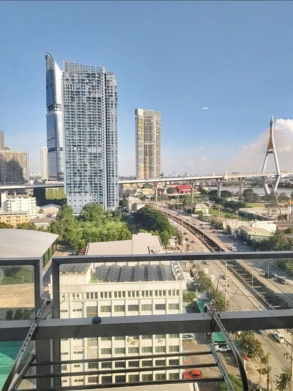
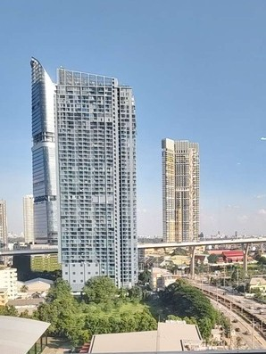
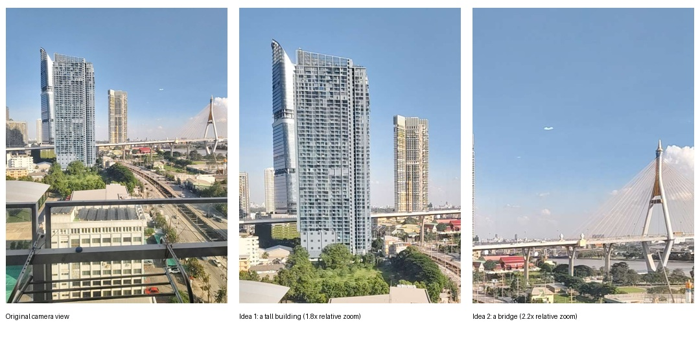
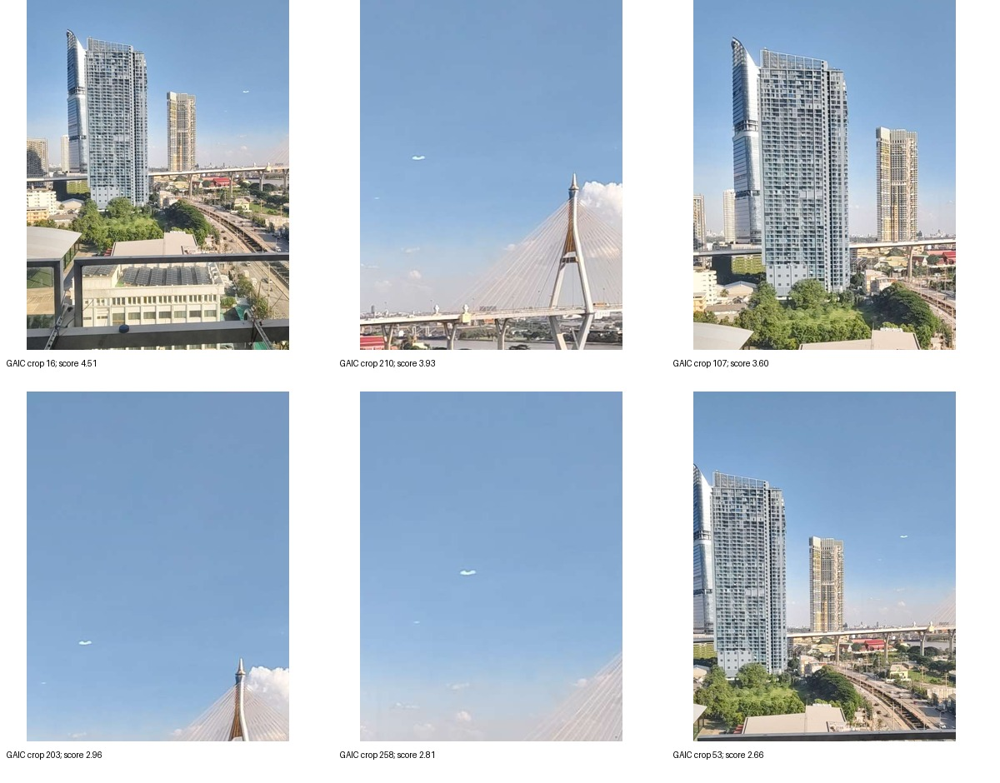

# Composition research gallery

These comparisons use a skyline view supplied by the project owner. They show how three desktop experiments use the same scene.

## Skyline and the current planner

| Starting view at 1× | Tighter view used in the keep test at 1.61× |
| --- | --- |
|  |  |

The Android planner replay compared 28 options from the starting view and selected the two towers at 1.61×. The image on the right was prepared separately as an already framed test input. The planner kept it when replayed at 1.61×. [Recorded results](../../research/results/level-indoor-replay.json).

## Earlier subject search

The subject search proposed two different photographs from the skyline. One emphasizes the towers at 1.8×. The other emphasizes the bridge at 2.2×. [Experiment notes](../ENVIRONMENT_COMPOSITION_RESEARCH.md#why-the-city-view-failed).

## Earlier crop ranking

These are six candidates from a dense crop search. Across the complete search, GAIC assigned its highest rating to the full view. That result motivated adding subject evidence to the composition decision. [Experiment notes](../ENVIRONMENT_COMPOSITION_RESEARCH.md#why-the-city-view-failed).

The images show framing choices from still-image replays. Live tracking, leveling, and saved-photo quality on the Vivo require a phone rehearsal. The benchmark datasets and reference clips are documented through their [research sources](../../research/README.md).
